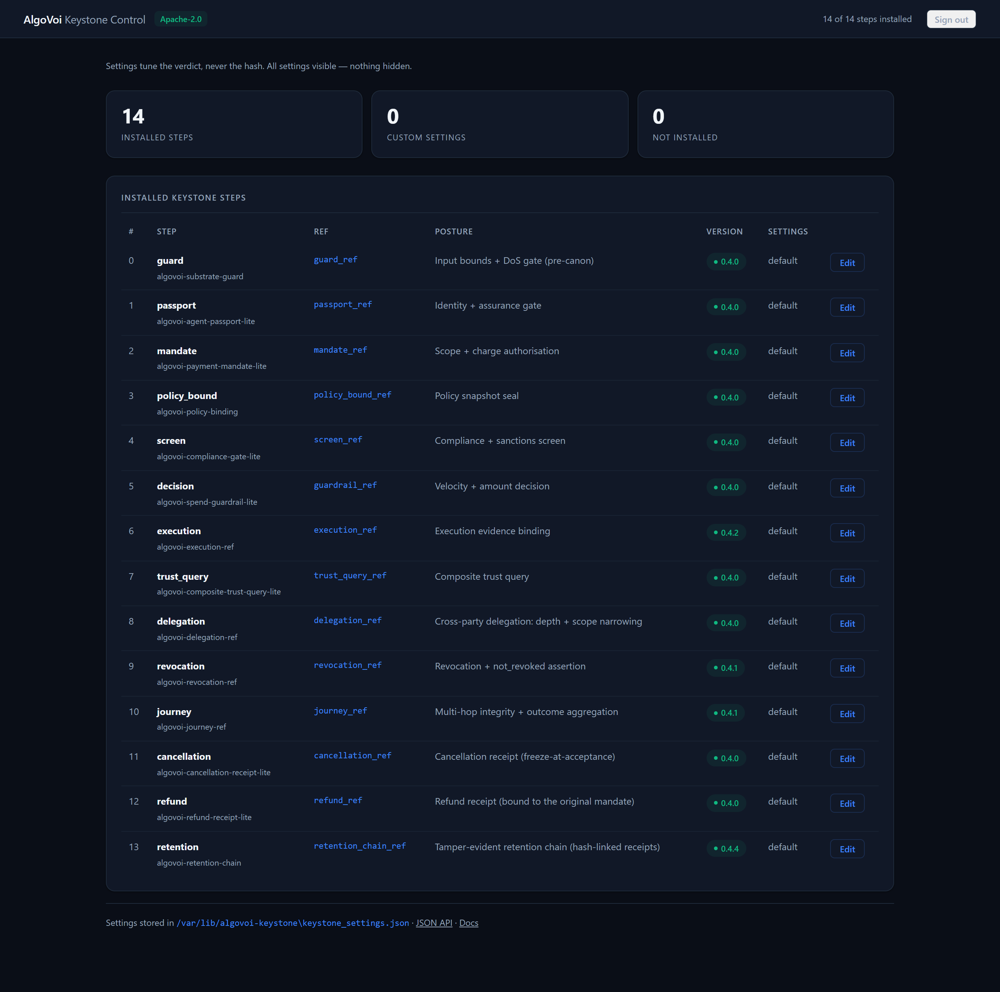
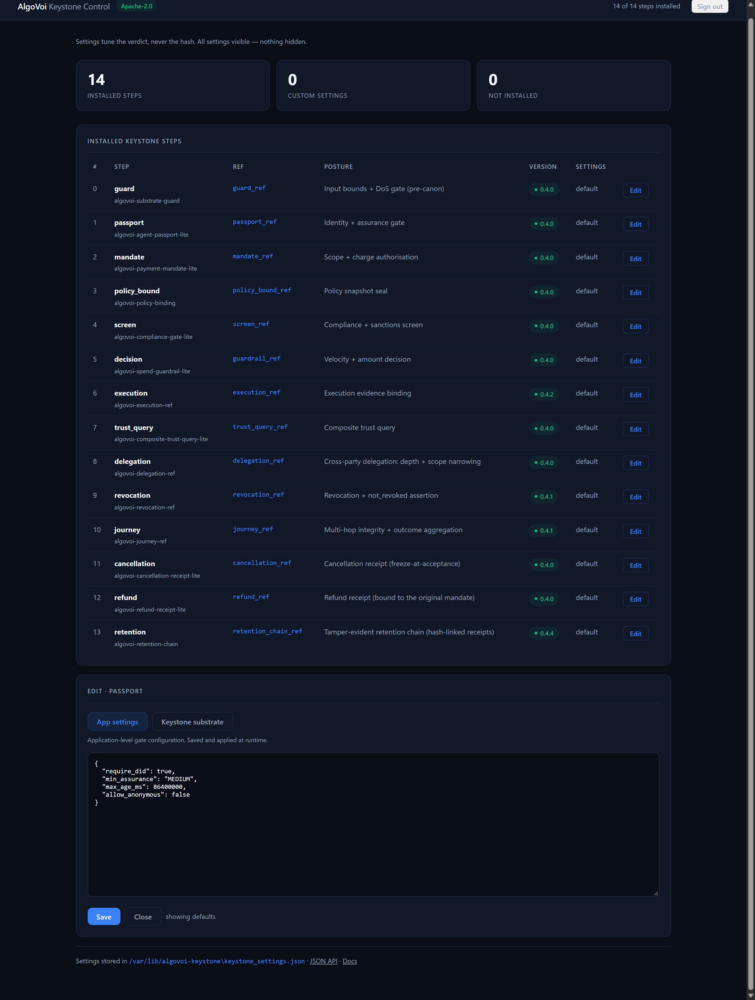
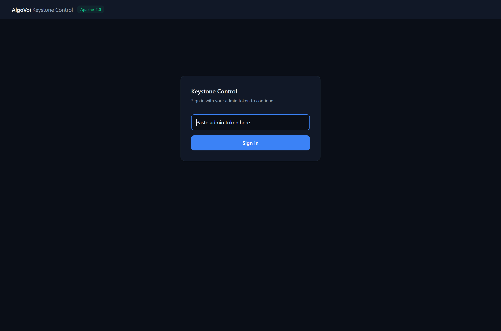

# algovoi-keystone

The **Keystone** is the L2 bolt-on layer on top of the L1 [AlgoVoi
substrate](https://github.com/chopmob-cloud/algovoi-substrate) (RFC 8785 JCS canonicalisation +
SHA-256). Where L1 gives you one primitive, `ref = "sha256:" + SHA-256(RFC 8785 JCS(payload))`, L2
gives you the toolchain to build, govern, run and verify agent actions against it, with no AlgoVoi
software in your trust base.

This repository is the open (Apache-2.0) Keystone SDK. It holds the framework itself — four
pure-Python packages plus the `keystone` command line — and every stage of the chain as an
installable package. All 19 are pure Python: `py3-none-any` wheels and sdists, no compiled
extensions, no Cython.

## Packages

### Framework

| Package | What it is |
|---|---|
| [`algovoi-keystone-connect`](packages/algovoi-keystone-connect) | build a data-plane connector from a declarative spec, and test any bolt-on at any stage of the chain offline |
| [`algovoi-keystone-agent`](packages/algovoi-keystone-agent) | the agentic behaviour layer: rules, triggers and behaviours that gate any write before it commits, each firing a content-addressed `behaviour_ref` |
| [`algovoi-keystone-runtime`](packages/algovoi-keystone-runtime) | run a chain and keep the evidence in a queryable, tamper-evident journal that recomputes offline |
| [`algovoi-keystone`](packages/algovoi-keystone) | the umbrella: one install for the whole toolchain plus the `keystone` CLI |

### The chain

Fourteen stages, in execution order. Each package declares itself through an
`algovoi.keystone.steps` entry point, so the control panel and `keystone` discover it without a
hardcoded catalogue.

| # | Step | Package | Ref it emits | What it establishes |
|---|---|---|---|---|
| 0 | `guard` | [`algovoi-substrate-guard`](packages/algovoi-substrate-guard) | `guard_ref` | input bounds and DoS hardening, before anything is canonicalised |
| 1 | `passport` | [`algovoi-agent-passport-lite`](packages/algovoi-agent-passport-lite) | `passport_ref` | who is acting, and at what assurance level |
| 2 | `mandate` | [`algovoi-payment-mandate-lite`](packages/algovoi-payment-mandate-lite) | `mandate_ref` | what that agent has authority to spend or do |
| 3 | `policy_bound` | [`algovoi-policy-binding`](packages/algovoi-policy-binding) | `policy_bound_ref` | exactly which policy snapshot governs the decision |
| 4 | `screen` | [`algovoi-compliance-gate-lite`](packages/algovoi-compliance-gate-lite) | `screen_ref` | whether compliance and sanctions screening permits the counterparty |
| 5 | `decision` | [`algovoi-spend-guardrail-lite`](packages/algovoi-spend-guardrail-lite) | `guardrail_ref` | the pre-payment ALLOW / DENY verdict |
| 6 | `execution` | [`algovoi-execution-ref`](packages/algovoi-execution-ref) | `execution_ref` | what actually happened, bound to the decision that permitted it |
| 7 | `trust_query` | [`algovoi-composite-trust-query-lite`](packages/algovoi-composite-trust-query-lite) | `trust_query_ref` | a composite trust verdict a third party can recompute |
| 8 | `delegation` | [`algovoi-delegation-ref`](packages/algovoi-delegation-ref) | `delegation_ref` | authority passed on legitimately, with depth and scope narrowing |
| 9 | `revocation` | [`algovoi-revocation-ref`](packages/algovoi-revocation-ref) | `revocation_ref` | whether any of it has since been withdrawn |
| 10 | `journey` | [`algovoi-journey-ref`](packages/algovoi-journey-ref) | `journey_ref` | the outcome across a whole multi-agent journey |
| 11 | `cancellation` | [`algovoi-cancellation-receipt-lite`](packages/algovoi-cancellation-receipt-lite) | `cancellation_ref` | a cancellation receipt, frozen at acceptance |
| 12 | `refund` | [`algovoi-refund-receipt-lite`](packages/algovoi-refund-receipt-lite) | `refund_ref` | a refund receipt, tied back to the original mandate and execution |
| 13 | `retention` | [`algovoi-retention-chain`](packages/algovoi-retention-chain) | `retention_chain_ref` | a hash-linked retention chain over the receipts |

Stages 0–5 authorise, stage 6 is the commit, and 7–13 account for what happened. The lifecycle
stages (9–13) only fire when something actually occurs: a clean execution touches 0–7, 10 and 13.

Plus one package that is not a stage:

| Package | What it is |
|---|---|
| [`algovoi-recompute-drift`](packages/algovoi-recompute-drift) | offline drift detection — recompute a recorded `action_ref` and assert it still matches (`recompute_action_ref`, `drift_detected`, `assert_no_drift`) |

## Control panel and the alias framework

This repository is the L2 layer. The **control plane** that governs a running L2 deployment is a
separate package, `algovoi-keystone-control` (Apache-2.0). It discovers which steps are installed,
binds each one to its canonical reference, and tunes policy settings — without ever changing how a
reference is computed.



The panel is driven entirely by what is installed. There is no hardcoded list of packages in it:
install a step and it appears, with its ref, its posture, its version and its editable settings.



Each step exposes its settings as JSON, split into the application-level gate configuration and the
keystone substrate variables. The panel states its own rule plainly: *settings tune the verdict,
never the hash* — so policy can change at runtime without invalidating any evidence already
emitted.



### How a step declares itself

Every chain package ships a `keystone.py` exposing one function through the
`algovoi.keystone.steps` entry point:

```python
def keystone_step() -> dict:
    return {
        "package": "algovoi-agent-passport-lite",
        "step": "passport",
        "ref": "passport_ref",
        "alias_of": "passport_ref",
        "order": 1,
        "posture": "Identity + assurance gate",
        "default": {"__keystone": {...}, "require_did": True, "min_assurance": "MEDIUM"},
    }
```

That is the whole contract. The package declares its own place in the chain, and the panel
discovers it by reading installed entry points — so a third-party bolt-on is governable the moment
it is installed, with no catalogue edit and no central registry.

### What "alias" means here

Three distinct aliases do three distinct jobs:

| Alias | Where it lives | What it guarantees |
|---|---|---|
| `alias_of` | the package's `keystone.py` | the package's reference **is** the canonical slot reference; it does not invent a parallel namespace |
| edition aliases | the panel's catalogue (`packages: [...]`) | the open edition and the commercial edition occupy the *same* step and ref, so a chain can swap editions without changing a single hash |
| parameter aliases | runtime and journal (`expect_head` / `expect_count`) | a pin can be named the way the caller already names it, so verification is not skipped over a spelling mismatch |

The important property is convergence. A step slot has exactly one canonical reference name, and
everything that fills that slot — open edition, commercial edition, or a vendor bolt-on — aliases
onto it. Two rules keep it honest:

- **No shadowing.** A bolt-on whose `step` or `ref` is already taken is skipped, so a package
  cannot hijack an existing slot by simply declaring itself into it.
- **Untrusted descriptors are validated.** Entry points are third-party code, so step and ref names
  are matched against a strict pattern, `order` must be integral, package names must be well formed,
  and the number of accepted vendor steps is capped.

### How the alias layer carries L2 into L3

| Layer | What it is | What the alias layer does for it |
|---|---|---|
| **L1** | the substrate primitive: `ref = "sha256:" + SHA-256(RFC 8785 JCS(payload))` | nothing — an alias never changes the preimage, so a ref computed anywhere recomputes identically here |
| **L2** | this SDK: build the chain, gate the write, run it, keep the journal | each stage knows its own `step`, `ref` and `order`, so the chain can be assembled and verified without a central schema |
| **L3** | the control plane: discover, bind, configure, audit | the panel governs a deployment it has never seen, because every artefact declares its own slot |

The consequence is that L3 never needs a copy of L2's catalogue. It reads the installed packages,
checks that each step resolves to a canonical ref, and presents it. Add a stage to a deployment and
governance extends to it automatically; remove one and the gap is visible as *not installed*
rather than silently absent from the chain.

That is also why settings and evidence are kept apart: L3 can tighten a threshold, change an
assurance floor or disable anonymous agents, while the `ref` for everything already recorded still
recomputes. Governing the process never rewrites the record.

### Running it

```
pip install algovoi-keystone-control
algv-keystone
```

It serves on `https://127.0.0.1:8077` and generates a self-signed certificate on first run. Set
`ALGV_ADMIN_TOKEN` to fix the sign-in secret, and `ALGV_PIN_GATE=1` to require a signed licence key
before settings can be edited.

## One install, one command

```
pip install algovoi-keystone

keystone new redis-stream --kind connector   # scaffold a bolt-on, green out of the box
keystone test                                 # recompute, decision-bound, tamper-evident
keystone validate records.json                # verify any emitted ref offline
keystone journal run.db                        # verify a run's evidence journal
```

The chain packages install the same way. They are published to the AlgoVoi open package index,
which also serves `#sha256=` fragments so you can pin:

```
pip install --index-url https://pip.algovoi.co.uk/simple/ \
            algovoi-substrate-guard algovoi-agent-passport-lite algovoi-payment-mandate-lite \
            algovoi-policy-binding algovoi-compliance-gate-lite algovoi-spend-guardrail-lite \
            algovoi-execution-ref algovoi-composite-trust-query-lite algovoi-delegation-ref \
            algovoi-revocation-ref algovoi-journey-ref algovoi-cancellation-receipt-lite \
            algovoi-refund-receipt-lite algovoi-retention-chain
```

## One import surface

```python
from algovoi_keystone import connector, rule, trigger, behaviour, Engine, Runtime, Journal, keystone_ref, behaviours

keystone_s3 = connector("s3", writes={"put_object": ("put", lambda c: c.kwargs["Bucket"])})
rt = Runtime(Journal("keystone.db"), decision_ref=decision_ref)
s3 = rt.bind(keystone_s3(client, decision_ref=decision_ref), behaviours=[behaviours.deny_writes_to("s3", "delete")])
```

A behaviour only fires at the stage it declares. Pair `Engine.guard` with a stage-appropriate
behaviour — a spend cap triggers at the `decision` stage, not inside a write guard — and check
coverage with `check_guard_coverage` rather than assuming a bound behaviour is an active one.

## The one guarantee

Every reference this SDK emits, `execution_ref`, `behaviour_ref`, a stage ref, or the journal head,
recomputes from its own fields with a stock RFC 8785 implementation and standard SHA-256. There is
nothing to trust and nothing to run: any third party verifies the evidence offline.

Build it and prove it yourself:

```
git clone https://github.com/chopmob-cloud/algovoi-keystone && cd algovoi-keystone
pip install -e packages/algovoi-keystone-runtime -e packages/algovoi-keystone
pytest packages
```

Every stage is exercised end to end — including tamper-evidence negatives, where a modified field,
a broken journal chain and a truncated journal must all fail verification.

## Plugins

These stamp a keystone decision onto the trace metadata an agent framework already collects, so
the evidence travels with the run. They are duck-typed — no framework import — and depend only on
`algovoi-substrate` and `rfc8785`.

| Plugin | Stamps onto |
|---|---|
| [`plugins/algovoi-keystone-langchain`](plugins/algovoi-keystone-langchain) | LangChain callback handler config and run metadata |
| [`plugins/algovoi-keystone-crewai`](plugins/algovoi-keystone-crewai) | CrewAI step and task metadata |
| [`plugins/algovoi-keystone-autogen`](plugins/algovoi-keystone-autogen) | AutoGen message metadata |
| [`plugins/algovoi-keystone-adk`](plugins/algovoi-keystone-adk) | Google ADK agent state updates and before-agent callbacks |

```python
from algovoi_keystone_langchain import keystone_trace_metadata, verify_trace_execution_ref

meta = keystone_trace_metadata(
    decision_ref="dec_01", action_type="transfer", scope="acct_42",
    outcome="ALLOW", executed_at_ms=1700000000000,
)
verify_trace_execution_ref(meta)   # True — recomputed, not trusted
```

## Adapters

Standards adapters carry a keystone decision into a foreign format, so the evidence survives the
journey into another ecosystem. Each ships a Python package and a TypeScript twin that produce the
same `execution_ref` byte for byte.

| Directory | Package | Carries the decision as |
|---|---|---|
| [`adapters/cloudevents`](adapters/cloudevents) | `algovoi-cloudevents` / `@algovoi/cloudevents` | a CloudEvents 1.0 event (`execution_ref` is the event `id`; refs in `data`) |
| [`adapters/keystone-mcp`](adapters/keystone-mcp) | `algovoi-keystone-mcp` / `@algovoi/keystone-mcp` | MCP tools so any MCP client recomputes and checks an `execution_ref` offline |
| [`adapters/keystone-vc`](adapters/keystone-vc) | `algovoi-keystone-vc` / `@algovoi/keystone-vc` | a W3C Verifiable Credential (DM 2.0) with `execution_ref` as `credentialSubject.id` |
| [`adapters/otel-genai`](adapters/otel-genai) | `algovoi-otel-genai` / `@algovoi/otel-genai` | OpenTelemetry attributes, with keystone refs under the vendor namespace `algovoi.keystone.*` |

Vendor-specific values always live under AlgoVoi-owned identifiers, never inside a namespace
governed by another standards body.

### Not open, not in this repository

The `*-journey` packages (`a2a-journey`, `autogen-journey`, `crewai-journey`,
`langgraph-journey`) are **commercial, bundle-only**. `crewai-journey` carries no licence field at
all in its metadata — it is commercial by intent and must not be treated as open. They bind a
whole multi-agent run into one `journey_ref`, the orchestrator capability, rather than a single
step.

## One guarantee, everywhere

Every package here — chain stage, adapter, plugin — recomputes rather than trusts. A missing,
malformed or tampered payload fails closed, and an `execution_ref` copied from a different span
does not authenticate another. Test it:

```
pip install pytest
pytest packages plugins adapters      # 281 cases, including the tamper negatives
npm test --prefix adapters/cloudevents/typescript   # and the TypeScript twins
```

Documentation: https://docs.algovoi.co.uk/keystone-sdk

## Licence

Apache-2.0. See [LICENSE](LICENSE) and each package's `NOTICE`.
